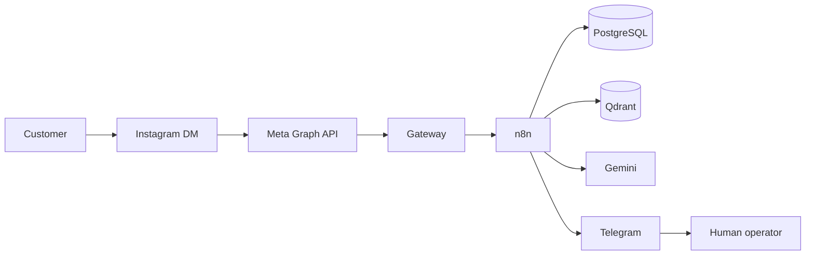
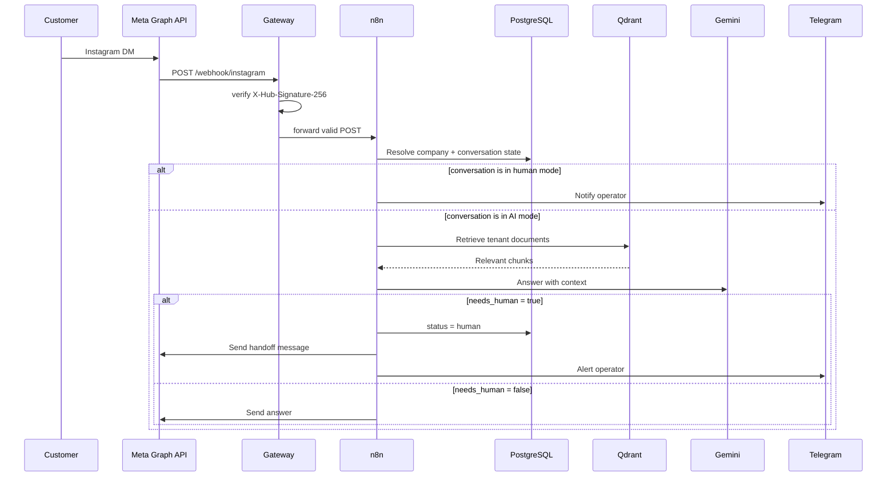

# Winery AI Assistant

A multi-tenant Instagram assistant that answers customer questions with RAG,
recommends wines and hands conversations to a human when the bot is not
confident.

> **Demo data is fictional.** The winery, wines, prices and schedules in
> `examples/demo/` are invented for demonstration purposes.


## Why this exists

Small businesses receive the same questions every day: opening hours, prices,
shipping, visit bookings. A generic chatbot hallucinates. A rigid FAQ bot cannot
handle natural language.

This project explores a middle ground:

- Ground every answer in a per-tenant knowledge base (RAG).
- Keep the conversation state in PostgreSQL.
- Escalate to a human when the model is unsure or the request is sensitive.
- Give the business a lightweight Telegram interface to take over a chat.
- Keep the deployment reproducible with Docker Compose.

## What it does

- Receives Instagram DMs through the Meta Graph API webhook.
- Verifies Meta's GET challenge and `X-Hub-Signature-256` in a small gateway before forwarding to n8n.
- Resolves the tenant from the Instagram account ID.
- Retrieves relevant chunks from a per-company Qdrant collection.
- Generates a structured answer with Gemini.
- Tracks `ai` / `human` conversation state in PostgreSQL.
- Sends a Telegram alert when a conversation needs a person.
- Lets an operator switch a conversation with `/ai`, `/human`, `/stats` and
  `/help`.
- Includes a local RAG demo that does **not** require a Meta developer account.
- Includes a Restic backup and restore runbook.

## Architecture



Request flow:



## Tech stack

| Layer | Technology |
|---|---|
| Public edge | FastAPI gateway + HMAC verification |
| Orchestration | n8n 3.1 |
| LLM | Google Gemini |
| Embeddings | `gemini-embedding-001` |
| Vector store | Qdrant 1.20 |
| Database | PostgreSQL 16 |
| Messaging | Meta Graph API (Instagram) |
| Human handoff | Telegram Bot API |
| Backups | Restic + Backblaze B2 (optional) |
| Local demo | Python 3.11+ |

## Quickstart

### Prerequisites

- Docker Engine with Docker Compose v2
- Python 3.11+
- A Gemini API key for the local RAG demo
- Optional: a Meta developer app and a Telegram bot for the full workflow

### 1. Configure the environment

```bash
cp .env.example .env
```

Edit `.env`:

- Set `POSTGRES_PASSWORD`.
- Generate `N8N_ENCRYPTION_KEY` with `openssl rand -hex 32`.
- Set `GEMINI_API_KEY`.

### 2. Start the infrastructure

```bash
docker compose up -d
```

This starts n8n, Qdrant, PostgreSQL and the gateway. PostgreSQL runs
`sql/init/001_schema.sql` and `sql/init/002_seed_demo.sql` on first boot.

n8n is available at <http://localhost:5678>. The gateway is available at
<http://localhost:8080> and is the only public entry point. Qdrant is bound to
`127.0.0.1:6333` for the local demo. PostgreSQL is not published to the host.

### 3. Run the local RAG demo

This path does not need Instagram or n8n.

```bash
python3 -m venv .venv
source .venv/bin/activate
pip install -r requirements.txt

python scripts/rag_ingest.py --recreate
python scripts/rag_query.py "¿Qué vino recomiendas para una barbacoa?"
```

If you use `make`:

```bash
make ingest
make ask Q="¿Qué vino recomiendas para una barbacoa?"
```

### 4. Import the n8n workflows (optional)

1. Open n8n and create the credentials it asks for: PostgreSQL, Qdrant,
   Google Gemini and Telegram.
2. Import `workflows/main.json` and `workflows/telegram-admin.json`.
3. Update the PostgreSQL and Qdrant credentials in each node.
4. Set the Instagram webhook callback to your public gateway URL:
   `https://<your-host>/webhook/instagram`. The gateway forwards to n8n.
5. Add a Telegram chat ID to the demo company before using the admin workflow.

The workflows are exported without credential IDs, webhook IDs or execution
data. They will never contain real tokens.

> **Production warning:** keep the gateway as the only public entry point.
> The n8n workflow itself does not verify signatures; the gateway rejects
> invalid requests before forwarding. Do not expose n8n directly. See
> [`docs/SECURITY.md`](docs/SECURITY.md).

## Configuration

| Variable | Required | Purpose |
|---|---|---|
| `POSTGRES_USER` | yes | Database user |
| `POSTGRES_PASSWORD` | yes | Database password |
| `POSTGRES_DB` | yes | Database name |
| `N8N_ENCRYPTION_KEY` | yes | Encrypts n8n credentials at rest |
| `N8N_HOST` | no | Public n8n hostname |
| `N8N_PROTOCOL` | no | `http` locally, `https` in production |
| `PUBLIC_BASE_URL` | gateway | Public URL of the gateway, e.g. the Cloudflare Tunnel URL |
| `FORWARD_TIMEOUT` | no | Gateway upstream timeout in seconds |
| `N8N_SECURE_COOKIE` | no | Set to `true` behind HTTPS |
| `QDRANT_API_KEY` | no | Required only if Qdrant is exposed |
| `GEMINI_API_KEY` | demo | Gemini API key for the local scripts |
| `INSTAGRAM_APP_SECRET` | gateway | Meta app secret for HMAC verification |
| `INSTAGRAM_VERIFY_TOKEN` | gateway | Meta webhook verification token |

## Demo

Real output from the local demo:

```text
$ python scripts/rag_query.py "¿Qué vino recomiendas para una barbacoa?"

Para una barbacoa recomendamos el Monastrell Reserva. Es un vino tinto
100 % Monastrell con 12 meses de barrica y notas de frutos negros y especias.
Marida muy bien con carnes rojas y asados. Su precio es de 22 €.

Fuentes:
  [1] bodega.md (score=0.7302)
  [2] bodega.md (score=0.6944)
  [3] bodega.md (score=0.6539)
  [4] bodega.md (score=0.6209)
```

This is a real run against the fictional demo data. The retrieval path is the
same one used by the n8n workflow.

## Project layout

```text
.
├── docker-compose.yml
├── examples/demo/          # Fictional knowledge base
├── gateway/                # Public webhook gateway (FastAPI)
├── scripts/
│   ├── rag_ingest.py       # Local ingestion into Qdrant
│   ├── rag_query.py        # Local RAG query CLI
│   ├── sanitize_workflow.py
│   ├── backup.sh
│   └── export_schema.sh
├── sql/init/               # Idempotent schema + demo tenant
├── workflows/              # Sanitized n8n exports
├── docs/
├── tests/
└── .github/workflows/ci.yml
```

## Data model

- `companies`: one row per tenant, including its Instagram account and Qdrant
  collection.
- `conversations`: one row per `(company, Instagram user)`, with `ai`/`human`
  state.
- `credentials`: encrypted provider tokens, one row per
  `(company, credential type)`.

The unique constraint on `(company_id, instagram_user_id)` is what makes the
handoff state machine safe when Meta retries a webhook.

## Testing and validation

```bash
pip install -r requirements-dev.txt
ruff check scripts tests gateway
pytest -q
docker compose config -q
python scripts/sanitize_workflow.py --check workflows/main.json workflows/telegram-admin.json
```

CI runs the same checks, validates the workflow JSON, runs ShellCheck and scans
the repository with Gitleaks. Gateway tests cover the GET challenge and the
HMAC rejection path.

## Security and privacy

- No real credentials, tokens or customer conversations are committed.
- `.env` is ignored; `.env.example` contains placeholders only.
- The gateway is the only public entry point; it verifies the verify token and
  the HMAC signature before forwarding to n8n.
- Qdrant and PostgreSQL are not published to the host by default.
- n8n binds to `127.0.0.1`; do not expose the editor.
- Execution data is pruned and not saved on success, reducing the chance of
  leaking tokens in n8n history.
- The production checklist is in [`docs/SECURITY.md`](docs/SECURITY.md).

If you operate this with real Instagram conversations, you are processing
personal data. You need a lawful basis, a privacy notice, a retention policy,
and data-processing agreements with Meta, Google and Telegram. See
[`docs/SECURITY.md`](docs/SECURITY.md).

## Implemented vs planned

| Capability | Status |
|---|---|
| Instagram DM webhook → gateway → n8n | Implemented |
| Meta GET verification | Implemented in gateway |
| `X-Hub-Signature-256` verification | Implemented in gateway |
| Tenant resolution by Instagram account | Implemented |
| Per-tenant RAG with Qdrant | Implemented |
| Human handoff state machine | Implemented |
| Telegram operator commands | Implemented |
| Local RAG demo without Meta | Implemented |
| Restic backup and restore runbook | Implemented |
| Google Calendar reservations | Not implemented |
| Cancellation / modification flows | Not implemented |
| Daily summary | Not implemented |
| In-n8n document ingestion | Not implemented (Python script used) |

## License

MIT. See [`LICENSE`](LICENSE).

## Acknowledgements

- [n8n](https://n8n.io/) for the workflow runtime.
- [Qdrant](https://qdrant.tech/) for the vector database.
- [PostgreSQL](https://www.postgresql.org/) for the relational store.
- Google Gemini for generation and embeddings.
