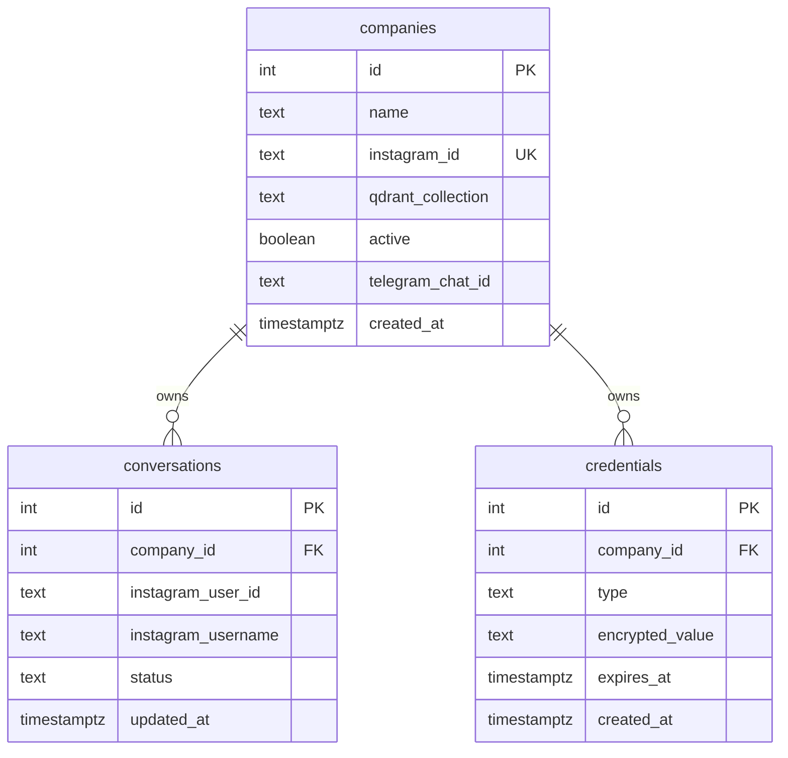
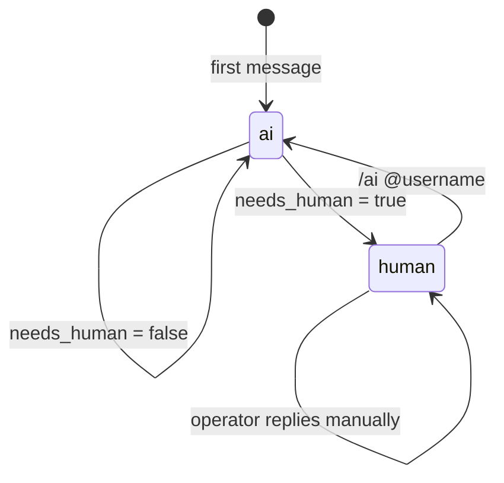

# Architecture

## Goals

- Answer Instagram DMs with information owned by each tenant.
- Never mix knowledge bases or conversation state between tenants.
- Escalate to a human when the model is unsure or the request is sensitive.
- Keep the operational surface small enough for a single small business.
- Make the local demo runnable without a Meta developer account.

## Non-goals

- A full CRM, inventory or invoicing system.
- A general-purpose chatbot platform.
- Kubernetes or microservices.
- Replacing a human for complaints, custom orders or negotiations.

## Components

| Component | Responsibility |
|---|---|
| Meta Graph API | Receives DMs and sends replies |
| Gateway | Public entry point: Meta challenge/HMAC + Telegram webhook proxy |
| n8n | Orchestration, retries and credentials |
| PostgreSQL | Tenants, conversation state and encrypted provider tokens |
| Qdrant | Per-tenant document embeddings |
| Gemini | Embeddings and answer generation |
| Telegram | Operator notifications and commands |
| Python demo | Local ingestion and query path without Meta |

## Request flow

1. Meta sends a webhook to the gateway.
2. The gateway validates the verify token on GET, or the
   `X-Hub-Signature-256` HMAC on POST.
3. Valid Meta requests are forwarded to n8n over the private Docker network.
4. Telegram sends admin updates to the same gateway; the gateway proxies the
   UUID webhook path and its secret header to n8n.
5. The n8n webhook validates the basic event shape and ignores echoes and
   non-text events.
6. `QueryID` resolves the tenant by the Instagram recipient ID.
7. `QueryEncrypted` loads the tenant's Instagram token.
8. `HTTPInstagramInfo` fetches the customer's profile.
9. `FirstConversationInsert` creates the conversation row if it does not exist.
10. `AiHumanQuery` checks whether the conversation is in `ai` or `human` mode.
11. In `ai` mode, the agent retrieves chunks from the tenant's Qdrant collection
    and generates a structured answer.
12. If `needs_human` is true, the conversation moves to `human`, the customer
    receives a handoff message and Telegram notifies the operator.
13. In `human` mode, the bot does not answer; it only notifies the operator.

## Multi-tenancy

Every tenant has:

- One `companies` row.
- One Qdrant collection name.
- One Instagram account ID.
- One Telegram chat ID.
- Zero or more encrypted provider credentials.

Conversation state is unique per `(company_id, instagram_user_id)`. This is the
key invariant that prevents a Meta retry from creating duplicate state or
leaking a conversation across tenants.

## Handoff state machine

The state is persisted, so an n8n restart does not lose the handoff decision.

## Why n8n

The target user is a small business, not a platform team. n8n provides:

- A visual audit trail of the integration.
- Built-in credential storage.
- Retries and error workflows without a custom scheduler.
- A fast path to replace Meta and Telegram connectors.

The trade-off is that the business logic lives in JSON rather than a typed
codebase. The repository mitigates that with a small Python demo path, SQL
schema, tests and sanitized exports.

## Why PostgreSQL

n8n stores its own workflow state in SQLite. PostgreSQL is used for application
state because it gives us:

- A real unique constraint for `(company_id, instagram_user_id)`.
- Transactions and foreign keys.
- A familiar backup/restore story.

## Why Qdrant per tenant

A shared collection with a `company_id` payload filter is possible. Separate
collections were chosen because they make accidental cross-tenant retrieval much
harder and allow deleting a tenant's knowledge base with one operation.

The cost is more collections to manage. At the scale of a small business, that
is acceptable.

## Failure modes

| Failure | Current behavior | Desired next step |
|---|---|---|
| Meta sends an echo or a non-text event | Filtered by the event guard | Add an automated test |
| Meta retries the same webhook | Conversation row is idempotent; reply may duplicate | Deduplicate by message ID |
| Gemini is unavailable | Node error; message is lost | Add retries and an error workflow |
| Instagram token expires | API call fails | Add a refresh job and expiry alert |
| Qdrant collection is missing | Retrieval fails | Add an ingestion health check |
| n8n restarts | Conversation state survives; in-memory chat buffer does not | Persist chat memory in PostgreSQL |

## Security boundaries

- The gateway is the only public endpoint and validates Meta's signature.
- The n8n editor is bound to `127.0.0.1` by default.
- PostgreSQL and Qdrant are not published to the host.
- Provider tokens are stored in the database and passed as headers at runtime.
- Execution data is pruned and not saved on success.
- The exported workflows contain no real credentials.

The signature verification lives in the gateway, not in n8n. See
[`SECURITY.md`](SECURITY.md).
